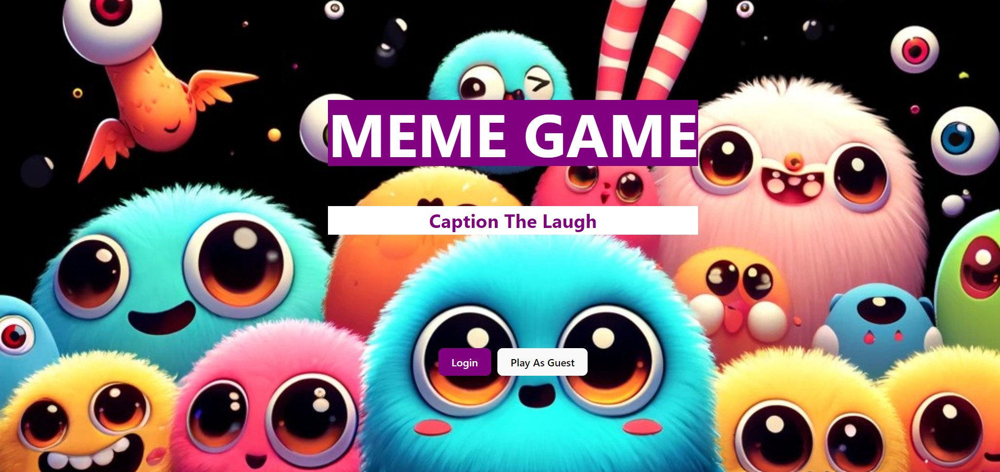
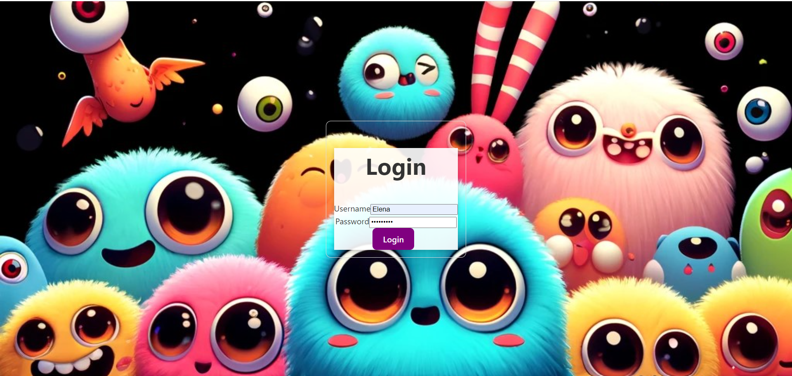
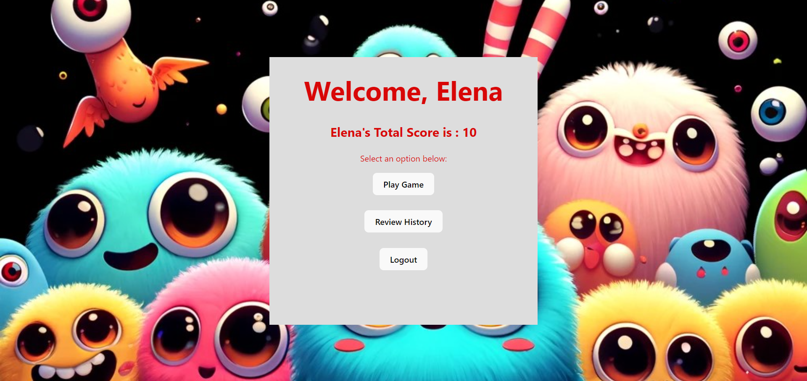
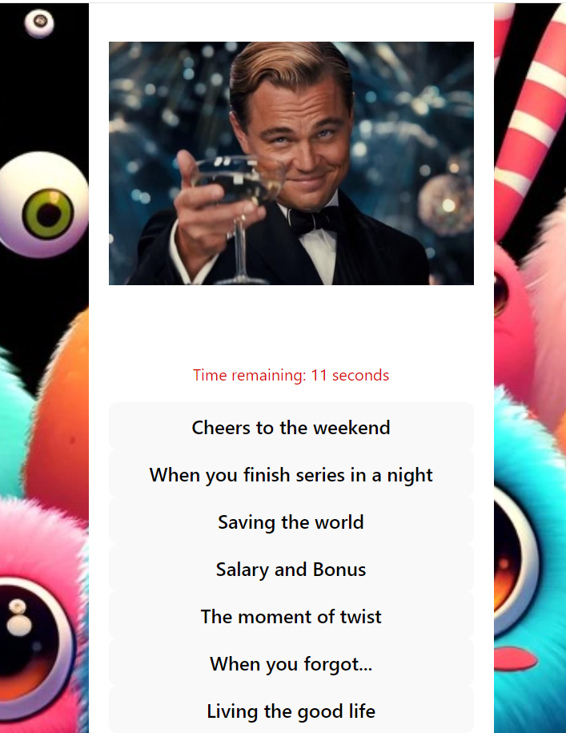
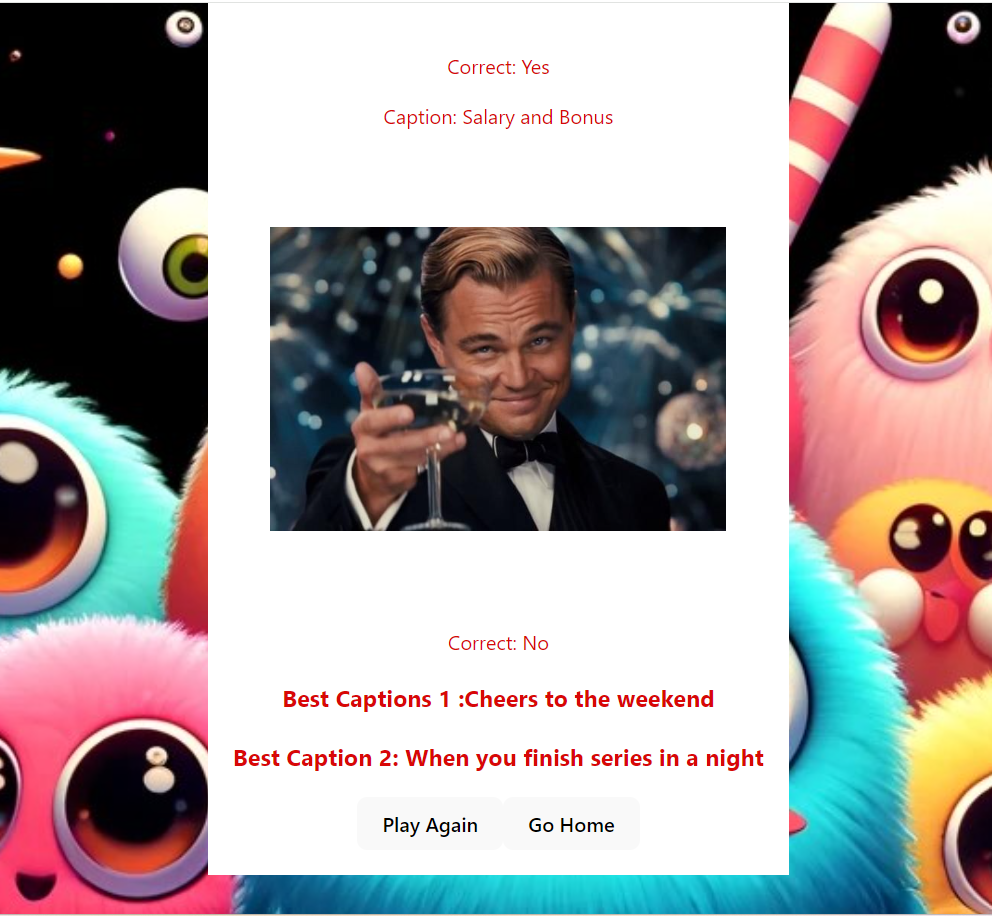
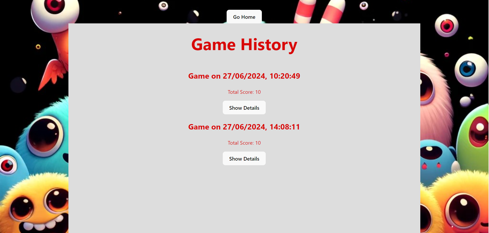
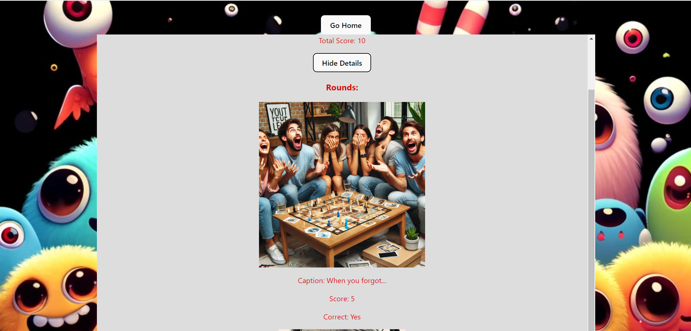

# Exam #1: "Meme-Game"
## Student: VAGHJIANI ANJALI NARENDRA 

## React Client Application Routes

- Route `/`: **Home**
  - The route / serves as the main entry point of our application, connecting to the Home.jsx component.
  - This is the first page users will see when they visit our application. It presents two primary options for the user:
    - Play as Guest: Navigates to the guest game page for instant access.
    - Login: Redirects to the login page for user authentication.

- Route `/login`: **LoginPage**
  - The route /login directs users to the login page, which is handled by the LoginPage.jsx component.
  - This page is crucial for user authentication and provides a straightforward interface for users to log in to their accounts.
  
- Route `/profile`: **ProfilePage**
  - The route /profile directs users to the profile page, which is handled by the ProfilePage.jsx component.
  - This page is accessible only to authenticated users and provides a personalized experience.
    
- Route `/profile`: **GamePage**
  - The route /game directs authenticated users to the game page, which is handled by the GamePage.jsx component.
  - This page provides an interactive experience where users can play a game by selecting captions for random meme images.
 
- Route `/profile`: **HistoryPage**
  - The route /history directs authenticated users to the history page, which is handled by the HistoryPage.jsx component.
  - This page allows users to view the history of all the games they have played.
  - For each game session, users can see an overview and have the option to view detailed information about each round played in that session.

- Route `/guest-game`: **GuestGamePage**
  - The route /guest-game directs users to the guest game page, which is handled by the GuestGamePage.jsx component.
  - This page allows users to play a single round of the game without needing to log in.

## Main React Components

- **`Home` (in `Home.jsx`)**: The Home.jsx component serves as the landing page for the application. It provides users with an initial point of interaction and offers them two primary options: to log in to their account or to play the game as a guest. This page is crucial for guiding users to the appropriate next step based on their preference for engaging with the application.
  - **Main Functionality**:
    - Login Option: Users can choose to log in to their existing account. This option navigates them to the login page (/login) where they can enter their credentials and gain access to the full features of the application, including their profile, game history, and the ability to play multiple rounds of the game.
    - Play as Guest Option: Users can opt to play the game as a guest. This option navigates them to the guest game page (/guest-game), where they can play a single round of the game without needing to log in. This option is ideal for new users who want to try out the game before creating an account.

      
- **`LoginPage` (in `LoginPage.js`)**: The LoginPage.jsx component serves as the entry point for users to log in to their existing accounts within the application.
  - **Main Functionality**:
    - The login page allows users to enter their credentials to access their accounts. It features:
      - Username Input: A field where users can input their username.
      - Password Input: A field where users can input their password.
      - Login Button: Once the user has entered their username and password, they can click the login button to submit their credentials.
    - When the login button is clicked, the application authenticates the user. If the credentials are correct, the user is redirected to their profile page. If the credentials are incorrect, the user receives an error message prompting them to try again.
   
- **`ProfilePage` (in Profile.jsx)**: The ProfilePage.jsx component serves as the central hub for logged-in users to manage their account and interact with various application features. It provides users with essential options such as playing games, reviewing game history, and logging out. Additionally, it displays the user's total score accumulated from game sessions, enhancing their engagement and sense of accomplishment.
  - **Main Functionality**
    - User Information Display: Displays basic information about the logged-in user, such as username
    - Navigation Options:
      - Play Game: Allows users to initiate a new game session by navigating to the game page (/game), where they can engage in interactive gameplay.
      - Review History: Provides users with access to their game history by navigating to the history page (/history), where they can review detailed information about past game sessions and their performance.
      - Logout: Enables users to securely log out of their account, terminating the current session and redirecting them to the login page (/login).
    - Total Score Display: Shows the cumulative total score achieved by the user across all game sessions.
    
- **`GamePage` (in `GamePage.js`)**: The GamePage.jsx component serves as the main interface for logged-in users to play the meme game. It presents users with a dynamic gameplay experience where they interact with meme images and captions, make selections, earn scores, and view game results. This page is designed to engage users in multiple rounds of gameplay and provide feedback on their performance.
  -**Main Functionality** 
    - Game Setup:
      - Start New Game: Users initiate a new game session, which includes fetching random meme images and their corresponding captions.
      - Game ID: Each game session is assigned a unique ID to track and save game-related data. the game.
    - Gameplay Mechanics:
      - Round Management: Users progress through multiple rounds of gameplay, where they have a 30sec to select the most fitting caption for displayed meme images.
      - Timer: A countdown timer tracks the remaining time for each round.
        
    - User Interaction:
      - Select Caption: Users click on captions presented alongside meme images to make their selections.
      - Score Calculation: Scores are dynamically updated based on the correctness of caption selections. Correct selections earn points, while incorrect selections may trigger additional game mechanics, such as displaying best captions.

    - Game Results:
      - Round Results: After completing each round, users receive feedback on their performance, including the correctness of their selections, round scores, and displayed captions.
      - Total Score: Users' cumulative scores across all rounds are displayed prominently upon completing the game session.

    - Navigation Options:
      - Play Again: Users have the option to restart the game session immediately after completing it, resetting scores and initiating a new round of gameplay.
      - Go Home: Users can navigate back to their profile page (/profile) at any point during or after the game session.

- **`HistoryPage` (in `HistoryPage.js`)**: The HistoryPage.jsx component provides logged-in users with a comprehensive view of their game history. It allows users to review details of past game sessions, including scores, rounds, and selected captions. This page enhances user engagement by offering insights into their gameplay progress and performance over time.
  - **Main Functionality**
    - Game History Display:
      - List of Games: Users can see a list of their past game sessions, each displayed as a summary.
      - Game Summary: Each game summary typically includes the total score achieved and options to view detailed round information.
     
    - Detailed Game View:
      - Show Details Button: Users can click on a "Show Details" button associated with each game session to expand and view detailed information about individual rounds played.
      - Round Information: Expanded details show users the rounds they played, the meme images displayed, the captions they selected, and the scores achieved for each round.
     
    - Navigation Options:
      - Go Home: Users have the option to navigate back to their profile page (/profile) from the top of the history page.
      - Play Again: For a seamless user experience, users can directly navigate to start a new game session by clicking on a "Play Again" button available on the detailed game view.
     
- **`GuestPage` (in `GuestPage.js`)**: The GuestPage.jsx component offers non-logged-in users the opportunity to experience a simplified version of the game without requiring account authentication. It provides a casual gaming experience where users can play a single round of the game, view their score, and optionally proceed to log in for more features.
  - **Main Functionality**
    - Gameplay for Guest Users:
      - Single Round Game: Allows guest users to play one round of the game with randomly selected meme images and caption options.
      - Interactive Gameplay: Provides buttons for selecting captions and submitting answers, enabling user interaction and engagement.
      - Score Display: Upon completing the round, displays the guest user's score achieved for that session.
     
    - Navigation Options:
      - Play Again: Guests can choose to play another round of the game by clicking on a "Play Again" button, which restarts the gameplay with new meme images and captions.
      - Login: Offers an option for guests to log in to their account for additional features.
     
    - Limited Privileges:
      - Score Display Only: Guest users can view their score for the current round but do not have access to detailed feedback or correct answers for captions.
      - Encouraged Login: Encourages guests to log in by providing a seamless transition to the login page (/login) for enhanced features and personalized experiences.
       

## API Server

- POST `/api/validate-caption`: This endpoint validates whether a given caption (captionId) matches the correct caption associated with a specific image (memeId).
  - request parameters and request body content:
    - memeId (Body Parameter): The unique identifier of the image (meme) for which the caption validation is requested.
      - Type: String
    - captionId (Body Parameter): The unique identifier of the caption to validate against the image.
      - Type: String
        
  - response body content: The response body contains JSON data indicating whether the provided caption (captionId) matches the correct caption for the specified image (memeId).
    - isCorrect: A boolean value indicating whether the provided caption is correct (true) or not (false).
      
  - response status codes and possible errors:
    - 200 OK: Successful validation of the caption. The response includes whether the caption is correct (true) or not (false).
    - 404 Not Found: If the specified caption (captionId) is not found for the given image (memeId).
    - 500 Internal Server Error: If there is an unexpected server error while validating the caption.
   
- POST `/api/best-captions`: This endpoint fetches the best captions associated with a specific meme (memeId), typically used to provide users with top-rated or most popular captions for a given image.
  - request parameters:- memeId (Body Parameter): The unique identifier of the meme for which the best captions are requested.
    - Type: String
   
  - response body content:- The response body contains JSON data representing the best captions associated with the specified meme.
    - bestCaptions: An array of objects representing the best captions.
      - captionId: Unique identifier for each caption.
      - text: The text content of the caption.
     
    - response status codes and possible errors:
      - 200 OK: Successful retrieval of the best captions for the specified meme. The best captions are returned in the response body.
      - 404 Not Found: If the specified meme (memeId) is not found.
      - 500 Internal Server Error: If there is an unexpected server error while fetching the best captions.
     
- POST `/api/login`: This endpoint handles user authentication using the username and password provided in the request body. It utilizes Passport.js middleware configured with a local authentication strategy ('local'), typically used for username-password authentication.
  - request parameters:-
    - username (Body Parameter): The username of the user attempting to log in.
      - Type: String
    - password (Body Parameter): The password associated with the username.
      - Type: String
     
  - response body content:- The response body contains JSON data indicating the result of the login attempt.
    - user: An object containing user information, typically including a unique identifier (userId) and other user details.
    - message: A message indicating the result of the login attempt.
    - success: A boolean flag indicating whether the login was successful (true) or not (false).
   
  - response status codes and possible errors:
    - 200 OK: Successful authentication and login. The response includes the user information and a success message.
    - 400 Bad Request: If authentication fails due to incorrect credentials. The response includes an error message indicating the reason for failure.
    - 500 Internal Server Error: If there is an unexpected server error during authentication or login process.

- POST `/api/save-game`: This endpoint is responsible for saving a completed game session into the database. It expects the total score achieved and details of each round played (rounds) as part of the request body. Additionally, it retrieves the user_id from the request body to associate the game with the correct user.
  - request parameters:-
    - total_score (Body Parameter): The total score achieved by the user in the game session.
      - Type: Number
    - rounds (Body Parameter): An array containing details of each round played in the game session.
      - Type: Array of Objects
     
  - response body content:- The response body contains JSON data with a message confirming the successful saving of the game session.
 
  - response status codes and possible errors:
    - 200 OK: Successful saving of the game session into the database. The response includes a success message.
    - 500 Internal Server Error: If there is an unexpected server error while saving the game session.
   
- POST `/api/logout`: This endpoint handles the logout functionality for a user. When called, it destroys the user's session on the server-side, effectively logging them out. It also clears the session cookie (connect.sid) from the client-side to ensure that the user is no longer authenticated.
  - request parameters:- None required in the request body or path parameters.
  - response body content:- The response body contains JSON data with a message indicating whether the logout was successful or failed.
  - response status codes and possible errors:
    - 200 OK: The logout operation was successful, and the session has been destroyed.
    - 500 Internal Server Error: If there is an unexpected server error while destroying the session or clearing the session cookie.
   
- POST `/api/save-round`: This endpoint is responsible for saving data related to a round of gameplay in a game session. It expects to receive roundData containing details about the round, such as the game ID, meme ID, selected caption ID, whether the caption was correct, the score for the round, and the completion timestamp.
  - request parameters:- roundData (Body Parameter): An object containing data related to the round being saved
    - Type: Object
    - Properties:
      - gameId: The unique identifier of the game session to which the round belongs.
        - Type: String or Number
      - memeId: The unique identifier of the meme associated with the round.
        - Type: String or Number
      - selectedCaptionId: The identifier of the caption selected by the user for the meme.
        - Type: String or Number
      - isCorrect: A boolean indicating whether the selected caption was correct.
        - Type: Boolean
      - score: The score achieved in the round.
        - Type: Number
      - completedAt: The timestamp when the round was completed.
        - Type: Date String (ISO 8601 format)

  - response body content:- The response body contains JSON data with a message indicating whether the round data was saved successfully.
 
  - response status codes and possible errors:
    - 200 OK: The round data was saved successfully.
    - 500 Internal Server Error: If there is an unexpected server error while saving the round data.
   
- GET `/api/start-game`: The /api/start-game endpoint is designed to start a new game for a user. It interacts with the gameDAO to create a new game instance and returns the game ID to the client.
  - request parameters:-
    - userId (Body Parameter): An object containing the user ID of the player who wants to start a new game.
      - Type: String or Number
     
  - response body content:- The response from the server will contain the gameId if the new game is started successfully.
 
  - response status codes and possible errors:
    - 200 OK: The new game session was successfully created, and the gameId is returned.
    - 500 Internal Server Error: If there is an unexpected server error while starting the new game session.
   
      
- GET `/api/random-image`: This endpoint retrieves a random image from the server to be used in a game or application.
  - request parameters:- This endpoint does not require any query parameters or request body.
  - response body content:- The response body contains JSON data representing the random image fetched from the server.
    - imageUrl: The URL of the random image
  - response status codes and possible errors:
    - Response Status Codes:
      - 200 OK: Successful retrieval of a random image. The image data is returned in the response body.
      - 500 Internal Server Error: If there is an unexpected server error while fetching the random image.
     
- GET `api/image-captions/:imageId` : This endpoint retrieves captions associated with a specific image identified by imageId.
  - request parameters:- imageId (Path Parameter): The unique identifier of the image for which captions are requested.
    - Type: String
    - Example: If imageId is 123, the endpoint path would be /api/image-captions/123.

  - response body content :- The response body contains JSON data representing the captions associated with the specified image.
    - captionId: Unique identifier for each caption.
    - text: The text content of the caption.
   
  - response status codes and possible errors:
    - 200 OK: Successful retrieval of captions for the specified image. The captions are returned in the response body.
    - 500 Internal Server Error: If there is an unexpected server error while fetching the captions.
      

- GET `/api/user/:userId/total-score` : This endpoint retrieves the total score of a user identified by userId.
  - request parameters and request body content:
    - userId (Path Parameter): The unique identifier of the user for whom the total score is requested.
      - Type: String

  - response body content:
    - The response body contains JSON data representing the total score of the user.
      - totalUserScore: The numeric value representing the total score of the user.
     
  - response status codes and possible errors:
    - 200 OK: Successful retrieval of the total score for the specified user. The total score is returned in the response body.
    - 500 Internal Server Error: If there is an unexpected server error while fetching the total score.  

- GET `/api/user/:userId/total-score` : This endpoint retrieves the game history of a user identified by userId. It returns a list of games that the user has played, typically including details such as game scores, rounds, and timestamps.
  - request parameters and request body content:
    - userId (Path Parameter): The unique identifier of the user for whom the game history is requested.
      - Type: String
     
  - response body content:
    - The response body contains JSON data representing the game history of the user.
    - gameId: The unique identifier of the game.
    - total_score: The total score achieved by the user in the game.
    - rounds: An array containing details of each round played in the game, including round identifiers (roundId), meme identifiers (memeId), selected caption identifiers (selectedCaptionId), correctness of the selection (isCorrect), score for the round (score), and completion timestamp (completedAt).
    - createdAt: The timestamp when the game was started or created
   
  - response status codes and possible errors:
    - 200 OK: Successful retrieval of the game history for the specified user. The game history is returned in the response body.
    - 500 Internal Server Error: If there is an unexpected server error while fetching the game history.
    
- PUT `/api/something`: purpose
  - request parameters and request body content
  - response body content
  - response status codes and possible errors
- ...

## Database Tables

- Table `Users` - The users table stores information about users who have registered in the system. Each user is uniquely identified by user_id. The username and password fields are used for authentication purposes, with the password stored in an encrypted form. The salt attribute adds additional security by randomizing the hashing process of the password.
  - Attributes
    - user_id: Unique identifier for each user in the system.
    - username: The username chosen by the user for logging into the system.
    - password: Encrypted password of the user for authentication.
    - salt: Salt used during the hashing process of the password to enhance security.
       
- Table `Captions` - The captions table stores textual captions. Each caption is uniquely identified by caption_id. The text attribute contains the actual content of the caption.
  - Attributes:
    - caption_id: Unique identifier for each caption entry in the table.
    - text: The text content of the caption.
      
- Table `Games` - The games table records information about individual game sessions played by users in the system. Each game session is uniquely identified by game_id and associated with a specific user identified by user_id. The total_score attribute stores the cumulative score achieved by the user during the game session. The created_at timestamp denotes when the game session started, providing chronological context. The completed field indicates the status of the game session, helping track ongoing and completed games.
  - Attributes:
    - game_id: Unique identifier for each game session in the system.
    - user_id:  Identifier of the user associated with the game session.
    - total_score: The total score accumulated by the user in the game session.
    - created_at: Timestamp indicating when the game session was started or created.
    - completed: Indicates whether the game session has been completed (true) or is ongoing/incomplete (false).
   
      
- Table `Meme_Captions` - The meme_captions table facilitates the association between memes or images and their corresponding captions in the system. Each record (identified by meme_caption_id) links a specific meme (meme_id) with a caption (caption_id). The is_best_match attribute specifies whether the caption is deemed the best match for the meme, providing additional context about the relevance or quality of the caption.
  - Attribues:
    - meme_caption_id:Unique identifier for each record in the table associating memes with captions.
    - meme_id:Identifier of the meme or image to which the caption is associated.
    - caption_id: Identifier of the caption associated with the meme.
    - is_best_match: Indicates whether the caption is considered the best match for the meme (true) or not (false).
  
- Table `Memes` - The memes table stores information about memes or images used in the system. Each meme is uniquely identified by meme_id. The image attribute stores the binary data or path/reference to the image file associated with the meme.
  - Attributes:
    - meme_id: Unique identifier for each meme or image entry in the table.
    - image: The actual image content or reference to the image associated with the meme.
   
- Table `Rounds` : The rounds table records information about individual rounds played within game sessions. Each round is uniquely identified by round_id and associated with a specific game session (game_id). The meme_id attribute identifies the meme or image used in the round, while selected_caption_id indicates the caption chosen by the user. The is_correct field denotes whether the user's selection was accurate, influencing the score attribute. The completed_at timestamp marks when the round concluded, providing chronological context.
  - Attributes:
    - round_id: Unique identifier for each round entry in the table.
    - game_id: Identifier of the game session to which the round belongs.
    - meme_id:  Identifier of the meme or image associated with the round.
    - selected_caption_id: Identifier of the caption selected by the user for the meme in the round.
    - is_correct: Indicates whether the selected caption is correct (true) or incorrect (false) for the meme.
    - score: The score achieved by the user in the round, based on correctness of the caption.
    - completed_at: Timestamp indicating when the round was completed or finished.
       

## Screenshots

#HomePage

#LoginPage

#ProfilePage

#GamePage

#GamePage(dashbord, this pages shows all the round with its responds and best captions)

#HistoryPage

#HistoryPage (detials of each rounds of a specific game)

## Users Credentials

| Username   | Password   |
|------------|------------|
| testuser      | testpassword  |
| Elena      | Password1  |
| test      | WebApplication  |

